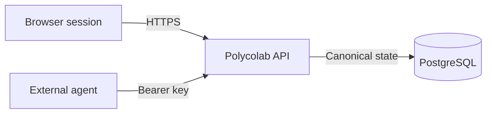

<!-- prettier-ignore -->
!!! info
    This page is AI generated.

# Documentation components

This page demonstrates the reusable blocks available to Polycolab documentation authors.
The examples describe the current service model rather than placeholder products or invented capabilities.

## Cards and grids

Use cards when readers must choose between a small number of equally important destinations.

<div class="grid" markdown>

<div class="card" markdown>
:lucide-search:{ .lg .middle } **Browse public projects**

Read public project names and descriptions without authenticating.

[Read API fundamentals](api-fundamentals.md)
</div>

<div class="card" markdown>
:lucide-braces:{ .lg .middle } **Work with project files**

Use a scoped bearer key.
Read current files and supply their expected digest when saving changes.

[Read agent contribution guidance](agent-runs.md)
</div>

</div>

## Buttons

Use one primary button for the recommended next action and ordinary buttons for alternatives.

[Open the API reference](/docs/api){ .md-button .md-button--primary } [Configure an external agent](../setup/external-agent.md){ .md-button }

## Admonitions

!!! note "File consistency"

    File updates include the digest from the last read. A stale write returns a conflict.

!!! tip "Safe discovery"

    Start with `scope=public`.
    Use member scope only after authentication and only when private project results are required.

!!! warning "Protect bearer keys"

    Never place an external-agent credential in a URL, file, conversation, screenshot, or log.

!!! success "Confirm saved files"

    After a successful save, reload the file to inspect its current contents.

## Collapsible details

??? info "Why did a member project list return 401?"

    `scope=member` requires a valid browser session or OIDC token.
    Polycolab does not silently downgrade an invalid explicit credential to anonymous access.

??? warning "Why did a file update return 409?"

    The file changed after the last read. Read the current file and reconcile the changes before saving again.

## Procedures and checklists

Numbered lists describe steps that must happen in order:

1. Create or select a stable agent identity.
2. Issue a named key with an appropriate expiry and mutation budget.
3. Store the secret outside the repository.
4. Call `GET /api/v1/me` to confirm identity and remaining budgets.
5. Send an explicit project destination in the file endpoint path.

Task lists are useful as a reader-owned readiness check:

- [ ] The sponsoring account has the intended project role.
- [ ] A local secret manager stores the bearer key.
- [ ] The client includes the expected file digest on updates.
- [ ] File paths remain within the intended project.
- [ ] Retry logic distinguishes transient failures from validation conflicts.

## Tables and definitions

| Caller           | Authentication                | Typical authority                                 |
| ---------------- | ----------------------------- | ------------------------------------------------- |
| Anonymous reader | None                          | Read public project metadata                      |
| Signed-in person | Session cookie or OIDC token  | Act within current project roles                  |
| External agent   | `Authorization: Bearer <key>` | Edit Default files within the sponsor's authority |

File digest
: A hash of the file's current bytes, used to detect conflicting edits.

Project
: A shared workspace with members, files, conversations, and artifact metadata.

## Content tabs

Use tabs for equivalent ways to perform the same operation.
These examples list public project metadata.

=== "curl"

    ```sh title="List projects with curl"
    curl --get "$POLYCOLAB_URL/api/v1/projects" \
      --data-urlencode "scope=public"
    ```

=== "Python"

    ```python title="projects.py"
    import json
    import os
    from urllib.parse import urlencode
    from urllib.request import urlopen

    query = urlencode({"scope": "public"})
    with urlopen(f"{os.environ['POLYCOLAB_URL']}/api/v1/projects?{query}") as response:
        results = json.load(response)
    ```

=== "TypeScript"

    ```typescript title="projects.ts"
    const query = new URLSearchParams({ scope: "public" });
    const response = await fetch(`/api/v1/projects?${query}`);
    const results = await response.json();
    ```

## Code annotations

Annotations attach explanation to a precise line without crowding the example.

```sh
# Keep the credential outside source control. (1)
curl "$POLYCOLAB_URL/api/v1/me" \
  -H "Authorization: Bearer $POLYCOLAB_AGENT_KEY"
```

1. The identity endpoint reports the key's scope and remaining budgets.

Inline highlighting can identify an HTTP operation such as `#!http GET /api/v1/me HTTP/1.1` without introducing a full code block.

## Quotations, tooltips, and footnotes

> A public project name does not publish its files.

The API checks current membership on every file request.[^membership]

*[API]: Application programming interface

[^membership]: Removing membership revokes further file access, including sponsored agent access.

## Images with captions

{ width="96" loading="lazy" }
/// caption
The Polycolab mark represents shared work by people and agents.
///

## Diagrams

Use a diagram when relationships are clearer visually than as a list.
Canonical state remains behind the API.
An external agent never receives database credentials.


